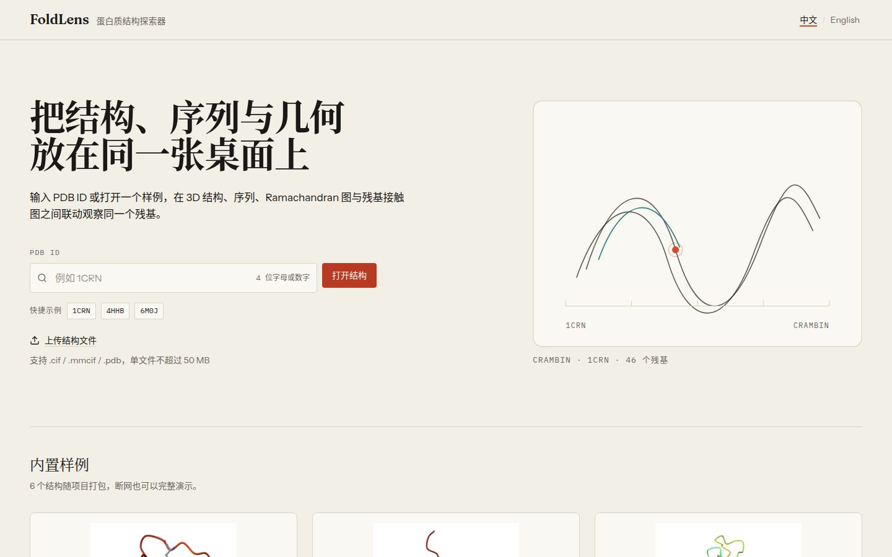
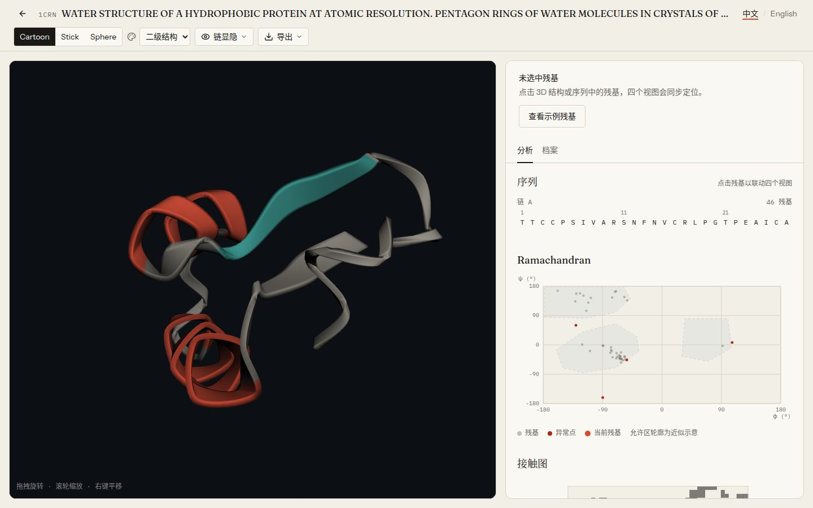
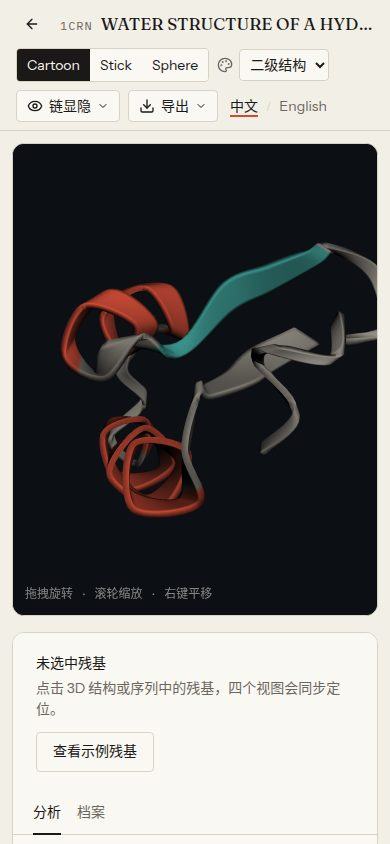

# FoldLens · 蛋白质结构探索器

> 输入一个 PDB ID，在三维结构、序列、Ramachandran 图和残基接触图之间联动观察同一个残基。
> 本地运行，离线可演示，中文 / English。

**课程项目**：生物信息学课程设计（本项目与医学人工智能无关）
**当前阶段**：标准版功能完成（M1–M4），本地可运行、可离线演示
**范围**：标准版（见下方“功能”）

---

## 这是什么

FoldLens 是一个面向生物信息学初学者的结构探索工具。它不是 PyMOL 的替代品，而是把四种最常用的结构视角做成一个共享选中状态的界面：

```
      3D 结构  ←── 同一个残基 ──→  序列
         ↕                              ↕
  Ramachandran 图  ←──────────→  残基接触图
```

点击任意视图中的残基，另外三个视图同步高亮；右侧读出它的 φ/ψ、二级结构、B-factor 和疏水性。

## 界面

| 首页 | 工作台 |
|---|---|
|  |  |

<p align="center">
  
  <br />
  <em>390px 宽度下的工作台</em>
</p>

---

## 功能（标准版）

- **首页**：PDB ID 搜索 + 6 个精选样例（1CRN、1UBQ、1LYZ、4HHB、6M0J、1L2Y）
- **3D 视图**：Cartoon / Stick / Sphere；按链显隐；五种配色（二级结构、链、疏水性、B-factor、元素）
- **序列**：按链分组，点击定位 3D
- **残基详情**：序号、三字母名、φ/ψ、二级结构、B-factor、疏水性
- **Ramachandran 图**：允许区轮廓 + 异常点标记 + 当前残基高亮
- **接触图**：Cα–Cα ≤ 8 Å 热图 + 当前残基十字线
- **结构档案**：方法、分辨率、R-free、链数、原子数、配体、缺失残基
- **导出**：3D 截图 PNG、分析数据 CSV
- **URL 状态**：`/entry/1CRN?chain=A&res=45&scheme=ss&repr=cartoon`，可分享、可刷新恢复
- **上传**：本地解析 `.cif` / `.mmcif` / `.pdb`（≤ 50 MB）
- **中英切换**：默认中文，科学术语保留英文
- **离线**：6 个样例随项目打包，断网也能完整演示

明确不做：配体口袋分析、表面渲染、结构对比、变异致病性预测、用户账户、云端同步。

---

## 技术栈

| 层 | 选型 |
|---|---|
| 前端 | React 19 + TypeScript 6.0.3 + Vite 8 + Tailwind 4 |
| 状态 / 路由 | Zustand 5 + React Router 7 |
| 3D | 3Dmol.js 2.5（懒加载） |
| i18n | i18next + react-i18next 17 |
| 后端 | FastAPI 0.162 + Uvicorn 0.54（本地 8000） |
| 结构计算 | Biotite 2.0 + NumPy 2.5（mmCIF 解析、P-SEA、二面角、接触图） |
| 运行 | 前端 5173，Vite 代理 `/api` → 127.0.0.1:8000 |

环境与依赖的完整清单见 [`docs/ENVIRONMENT.md`](docs/ENVIRONMENT.md)。

---

## 文档地图

| 文档 | 先读它，如果你想… |
|---|---|
| [`AGENTS.md`](AGENTS.md) | **接手开发**（任何 AI / 新会话的第一入口） |
| [`PRODUCT.md`](PRODUCT.md) | 了解产品事实、用户、范围与原则 |
| [`docs/PROJECT.md`](docs/PROJECT.md) | 看完整的项目总设计与验收标准 |
| [`docs/ARCHITECTURE.md`](docs/ARCHITECTURE.md) | 看架构、API 契约、数据模型、算法规格 |
| [`DESIGN.md`](DESIGN.md) | 看设计 token 与视觉规范 |
| [`docs/CONVENTIONS.md`](docs/CONVENTIONS.md) | 看代码、命名、i18n、Git 统一规约 |
| [`docs/ROADMAP.md`](docs/ROADMAP.md) | 看当前进度与下一任务 |
| [`docs/DEVLOG.md`](docs/DEVLOG.md) | 看最近一次做到哪、验证结果与待办 |
| [`docs/DEMO.md`](docs/DEMO.md) | 看三分钟答辩演示脚本 |
| [`docs/ENVIRONMENT.md`](docs/ENVIRONMENT.md) | 装环境、启动、排错 |

> 更换 AI 模型或对话窗口时，让新会话先读 `AGENTS.md`。仓库是唯一可靠的上下文。

### 换 AI / 新对话窗口时

把下面这段直接发给新的会话：

```text
你是 FoldLens 项目的接续开发者。请先完整阅读仓库根目录的 AGENTS.md，
按其中的“新会话开场顺序”执行；不要依赖上一个对话的记忆。
读完后用 3–5 行告诉我：当前阶段、上次做到哪、下一步是什么、有无阻塞。
在我确认之前不要开始写代码。
```

项目目录不变的前提下，技能、uv、Chromium 等本机环境都已经就位。

---

## 目录结构

```
FoldLens/
├── AGENTS.md / CLAUDE.md / README.md
├── PRODUCT.md / DESIGN.md
├── docs/                  # 项目设计、架构、规约、路线图、开发日志
├── frontend/              # React + Vite
│   └── src/
│       ├── app/           # 路由与全局 Provider
│       ├── components/    # 通用 UI
│       ├── features/      # home / workspace / structure / sequence / analysis
│       ├── i18n/          # zh / en
│       ├── lib/           # API 客户端、格式化、数学
│       ├── stores/        # Zustand
│       ├── types/         # 共享类型
│       └── styles/        # tokens 与全局样式
├── backend/               # FastAPI + Biotite
│   ├── app/               # api / core / services / models
│   ├── tests/
│   └── pyproject.toml
├── data/
│   ├── samples/           # 6 个 mmCIF（入库）
│   └── thumbnails/        # 6 张缩略图（入库）
├── scripts/               # setup / dev / fetch-samples / design-check
└── .cache/                # 运行时缓存（不入库）
```

---

## 快速开始

```bash
# 一次性安装（创建 backend/.venv、安装前端依赖、校验 6 个样例）
./scripts/setup.sh

# 同时启动前后端
./scripts/dev.sh
# 打开 http://localhost:5173
```

手动启动：

```bash
# 后端
cd backend
~/.local/bin/uv sync --locked --extra dev --python 3.12
.venv/bin/uvicorn app.main:app --reload --port 8000

# 前端
cd frontend
npm install
npm run dev
```

验证：

```bash
cd backend && .venv/bin/pytest && .venv/bin/ruff check .
cd frontend && npm run build && npm run lint
./scripts/design-check.sh
```

> 六个样例与缩略图随仓库打包；首次打开非样例条目时才需要联网访问 RCSB。
> 脚本会自动选择符合 Vite 8 要求的 Node（`^20.19.0 || >=22.12.0`）；手动运行 `npm` 前先 `nvm use`（项目根有 `.nvmrc`）。

---

## 数据来源

- 结构数据：[RCSB PDB](https://www.rcsb.org/)
- 样例缩略图：RCSB PDB 官方结构图像
- 二级结构：Biotite 的 P-SEA 实现（Labesse et al., 1997）
- 疏水性标度：Kyte & Doolittle, 1982

PDB 数据的使用请遵循 [RCSB PDB 使用条款](https://www.rcsb.org/pages/policies)。本项目仅用于课程学习与演示。

---

## 许可

课程项目，暂未指定开源许可。未经作者同意，请勿用于商业用途。
